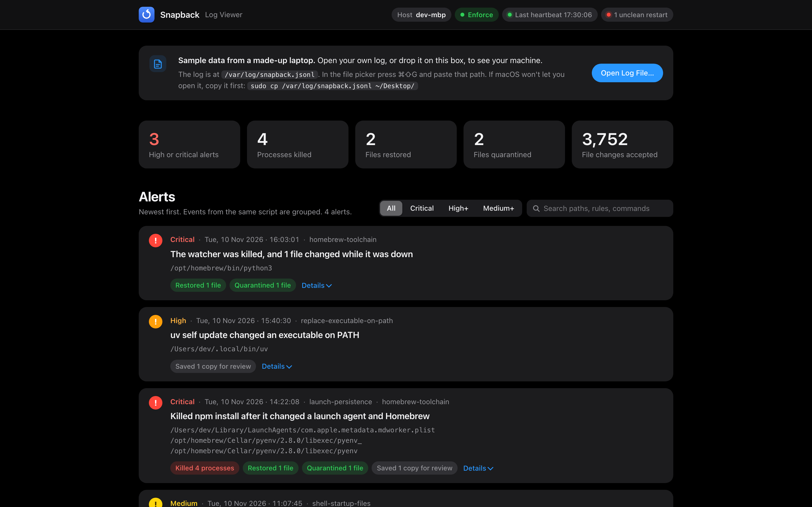
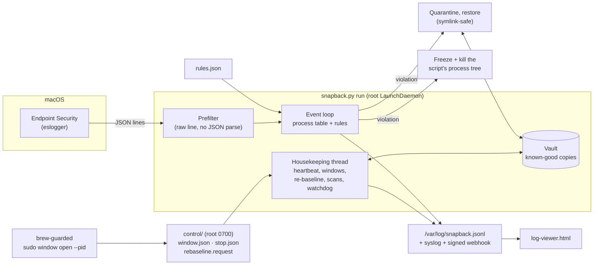

<p align="center">
  
</p>

# Snapback (prototype)

A root watcher for macOS 13+ aimed at the case where an attacker is already running code as a developer, through a malicious repo, package hook, extension or stolen session. It watches the things such an attacker goes after first and reacts within milliseconds:

- **Toolchain tampering** (Homebrew, pyenv, global npm and Python packages, PATH): kills the script's process tree, restores the files from a root-owned vault and quarantines what was written. A tampered binary that gets *run* before the revert lands is killed at exec.
- **Persistence** (launch agents and login items, shell, git, ssh and AI-tool config, Python startup hooks, cron, sudoers): alerts with a saved copy of the change.
- **Credential theft** (SSH keys, cloud CLI tokens, keychains, browser cookies and passwords, wallets): alerts when anything outside an allow list reads them.
- **Attack commands** (reverse shells, password-phishing dialogs, keychain dumps, disabling Gatekeeper, adding root certificates): kills the high-confidence ones, alerts on the rest.
- **System events** (SSH and screen-sharing logins, new users and admin-group changes, privacy permission grants, new background items, configuration profiles, XProtect detections, failed sudo): alerts.

It is a prototype for a test machine or a small pilot. Read [Limits](#limits) before relying on it, and [Roadmap](#roadmap) for the plan to turn it into a complete endpoint agent. The most important one is that it **reacts, it does not block**: macOS only lets a process deny an operation in advance if it holds Apple's Endpoint Security entitlement.

It comes with a local UI for reviewing what it caught and what it did about it ([Log viewer](#log-viewer)):



## Background

[Binance's initial report on its 29 October 2026 incident](https://x.com/binance/status/2117626126214504729) describes an engineer running a fake job-interview "assignment" repository whose setup step swapped a Homebrew-installed `pyenv` for a trojan that ran commands and talked to an attacker's server. Their endpoint security did not detect it. The report lists the file operations:

```
CREATE  /opt/homebrew/Cellar/pyenv/2.8.0/libexec/pyenv_
MODIFY  pyenv_ -> 3,414 B
DELETE  .../libexec/pyenv  (3,344 B)    <- remove the valid pyenv
RENAME  pyenv_ -> pyenv  (3,414 B)      <- replace it with a malicious version
DELETE  /opt/homebrew/bin/pyenv
ln (create a new symlink)  +  spawn zsh
```

On Apple Silicon, `/opt/homebrew` is owned by the developer's own account, so any script they run can rewrite it without sudo. Snapback treats every write there as a violation unless brew makes it, started from the `brew-guarded` wrapper during a maintenance window. It matches on file paths, kernel-attested process identity and the process tree, not malware signatures, so obfuscating the script does not hide these steps. `simulate_attack.sh` replays the sequence with a harmless payload, and `test_snapback.py` checks the kill, the restore and the quarantine.

## Files

| File | Purpose |
|---|---|
| `snapback.py` | The watcher and its CLI (Python 3.7+, standard library only) |
| `rules.json` | What to protect, what to detect, who is allowed. Ships in `audit` mode |
| `com.example.snapback.plist` | LaunchDaemon: runs as root, restarted by launchd if it dies |
| `brew-guarded` | `brew` wrapper that opens a maintenance window bound to itself |
| `install.sh` | Installs, baselines and starts it (`--uninstall` removes it) |
| `simulate_attack.sh` | Replays the post-mortem steps with a harmless payload |
| `test_snapback.py` | 153 automated checks with synthetic events and real processes (no root needed) |
| `log-viewer.html` | The UI: a single local page for the alert log (status, totals, alerts, edit history). Ships with sample data |
| `docs/log-viewer.png` | Screenshot of the UI |
| `docs/logo.png` | Project logo |

## How it works



**Events in.** The daemon starts Apple's `/usr/bin/eslogger` and reads its JSON lines. It subscribes to process events (`exec`, `fork`, `exit`, `signal`), file events (`create`, `rename`, `unlink`, `link`, `close`, `clone`, `copyfile`, `exchangedata`, `setmode`, `setowner`, `truncate`, `utimes`, `open`) and whatever system events the rules name. Most events on a dev machine have nothing to do with the rules, so a prefilter decides from the raw line whether an event is worth parsing. That cuts the cost of an irrelevant event from about 19 µs to under 5 µs, and it fails open: anything it can't classify gets parsed. A gap in eslogger's `global_seq_num` means events were dropped, and that raises an alert and triggers an immediate scan. If no events arrive for 60 s, the stream is assumed suspended and eslogger is restarted.

**Who is allowed: kernel-attested facts only.** Allow rules match the executable path and the *script* path the kernel reports for each exec (for `#!` scripts), the code-signing identity (`TEAMID:signing.id`, or `platform:` for Apple's own binaries), and the platform-binary flag. Command lines are never used for an allow decision, because any process can set its own argv. A process the watcher only knows from `ps` is never trusted. An allowed tool started with code-injecting environment variables (`BASH_ENV`, `BASH_FUNC_*`, `DYLD_*`, `NODE_OPTIONS`, `PYTHONPATH`, a `PYENV_HOOK_PATH` outside protected directories, and so on) is not trusted either.

Outside maintenance windows, only the allowed tool itself may write, or an Apple non-interpreter helper it runs directly (`cp`, `ln`, `mkdir`). Arbitrary descendants may not, so `PATH=/tmp/evil:$PATH pyenv rehash` doesn't hand the attacker's fake `rm` pyenv's permission.

**Rules.** There are three kinds in `rules.json`:

| `type` | Matches | Typical actions |
|---|---|---|
| `files` (default) | File events under `paths`, filtered by `include` / `exclude` globs. `"access": "read"` matches any `open` (for credential stores) | `kill`, `revert`, `alert`, `snapshot` |
| `exec` | Exec events whose `executable`, `script` or `args` match regexes in `match` (and none in `exclude_match`) | `kill`, `alert` |
| `event` | System events listed in `events`, optionally filtered by `match` on fields of the event | `alert` |

`allow` takes `users`, `ancestor_paths` / `ancestor_regex` (matched against executable and script paths), `signing_ids`, `platform_binaries` (`"all"` or `"non_tools"`, which excludes general-purpose tools like `cat`, `cp`, `curl`, `osascript` and interpreters), `protected_images` (binaries, or scripts run by an interpreter, that sit in a protected tree and match the vault), `only_during_window`, and `helpers`. Each rule can set its own `mode` (`audit` or `enforce`) and `kill_scope` (`script`, `session` or `process`).

**On a violation.**
1. *Kill.* Starting at the process that acted, the watcher walks up through interpreters (`sh`, `node`, `npm`, `python` and so on) to find the script running it, stopping below your terminal or editor session. It flags and SIGSTOPs that tree, re-scans for children until no new ones appear, then SIGKILLs all of it. Anything a flagged process forks or execs later is killed as it appears. If the chain comes in over SSH, the whole remote session's shell is killed, because remote logins to a dev laptop are rare and an attacker's shell shouldn't survive (`kill_remote_sessions`).
2. *Revert.* Whatever is at the path is moved to quarantine (root-owned, never executable). The known-good file, symlink or directory is restored from the vault with its mode and owner. A protected directory that was renamed away is moved back. A file not in the baseline (like `pyenv_`) is quarantined and nothing is restored.
3. *Alert.* One JSON record with the rule, the paths, the process chain (with signing identity and script for each process) and every action taken. Repeated events from an already-killed process are logged as `followup` and not re-sent.

In `audit` mode the same record says `would_kill` / `would_revert` and nothing is touched.

**Exec-time integrity.** Whenever a file under a `revert` rule is executed, as a binary or as a `#!` script, it is checked against the vault: a stat comparison, plus a hash if the stat differs. A modified or unknown file is killed and restored before it gets far. This covers the gap between a tampering write and its revert, and anything the event stream missed.

**Symlink-safe repairs.** The daemon runs as root but repairs files inside directories the developer can write to. Every repair resolves the path one directory at a time with `O_NOFOLLOW` and then acts through directory descriptors, with temporary names that are random and opened `O_EXCL`. A symlink planted anywhere in the path makes the operation fail instead of landing elsewhere. Hashing reads through the same `O_NOFOLLOW` descriptor it checked. Quarantine doesn't chmod a file that has other hard links.

**The vault.** `/Library/Application Support/Snapback/vault` (root only) holds a manifest of every protected path: type, mode, owner, size, mtime, **ctime**, inode, SHA-256 and symlink target. It also keeps a content-addressed copy of every protected file up to 5 MB. ctime can't be set from user space, so restoring the mtime with `touch -r` after an in-place edit doesn't fool the fast scan. Larger files can be detected but not restored; the alert then says which formula to reinstall.

**The baseline changes only on purpose.**
- *Maintenance window.* `brew-guarded` runs `sudo snapback.py window open --pid $$` before a changing brew command. Only processes descended from that wrapper, with brew in their attested chain, may write. The window closes the moment the wrapper exits, even if the terminal is closed mid-upgrade. When it closes, only the paths brew was seen touching are accepted, and the next scan reverts anything else. If events were dropped during the window, everything under the window's rules is accepted (so a real upgrade isn't broken) and a warning lists the files accepted without attribution. Scans of other rules keep running during a window.
- *Allowed tools outside a window* (such as `pyenv rehash`). Only the exact paths they touched are re-baselined, a few seconds after they go quiet.
- *`sudo snapback.py baseline`* accepts the current state of everything.

Every re-baseline writes a `rebaselined` record listing the files it added, changed and removed, what triggered it, and which command made the change.

**Housekeeping.** A thread wakes every second. It writes a heartbeat (with event, skip and drop counters and the age of the last event), notices windows closing, runs re-baselines that are due, watches the event stream, and every 120 s compares the protected trees with the vault, re-hashing everything on every 10th scan. A scan also runs at startup.

**Protecting itself.** It runs as root under launchd with `KeepAlive`, so the developer's account can't kill it, and launchd restarts it if root does. Rules, control files and the log are root-only: malware running as the developer can't read the webhook secret, see when a window is open, or edit alerts. `snapback.py stop` is the only quiet way to stop it. Any other SIGTERM sends a `stopped` alert, flushed to the webhook before exit, and leaves a marker. On restart, a marker from the current boot is reported as a critical tamper (killed or stopped), while one from before the boot is just a reboot. Signals and `kill` / `launchctl` commands aimed at it are reported as `tamper_attempt`.

**The log.** `/var/log/snapback.jsonl` (root:wheel 0640) holds one JSON object per line. Records also go to syslog, and to `webhook_url` if set, from a worker thread with retries. With `webhook_secret` set, each POST carries `X-Snapback-Signature: sha256=<HMAC of the body>` so the receiver can reject forgeries. Have the receiver alert when heartbeats stop: that is the only way to notice a watcher that root has removed.

| `type` | Written when |
|---|---|
| `violation` | A rule was broken. `rule_type` says `files`, `exec` or `event`; includes the process chain and actions |
| `drift` | A scan found a change; no process attribution |
| `tamper_attempt` | A signal or command aimed at the watcher, a stalled event stream, or a restart after an unauthorized stop |
| `warning` / `error` | Dropped events, unattributed window changes, eslogger exited or lacks an event type, a handler failed |
| `window` | A maintenance window opened or closed, by whom, bound to which pid |
| `rebaselined` / `baselined` | Changes accepted into the baseline, with the files involved |
| `started` / `stopped` / `stop_authorized` / `started_after_reboot` / `heartbeat` | Lifecycle and liveness |

**Example: the attack.** Say the repo's setup ran from `npm install`. The script creates `/opt/homebrew/Cellar/pyenv/2.8.0/libexec/pyenv_`. No window is open and brew isn't in its chain, so this is a violation. The script, its shell and `npm` are frozen and killed, `pyenv_` is quarantined, and any later steps that already landed are reverted. If the trojan had been swapped in faster than that, the shell init that runs `pyenv` would be killed at exec, because the file no longer matches the vault. `log-viewer.html` ships with this scenario as its sample data.

## Install and test

```bash
sudo bash install.sh
sudo tail -f /var/log/snapback.jsonl      # watch for "started" and heartbeats
sudo /usr/bin/python3 -I "/Library/Application Support/Snapback/bin/snapback.py" test-alert
```

eslogger needs Full Disk Access for the process that starts it. If `/var/log/snapback.err` shows eslogger exiting with a permission error, grant Full Disk Access to the Python binary it names, then `sudo launchctl kickstart -k system/com.example.snapback`. On a fleet, push a PPPC profile from MDM instead.

To prove it works, set `"mode": "enforce"` in `/Library/Application Support/Snapback/rules.json`, restart it with the `kickstart` command above, then as your normal user:

```bash
bash simulate_attack.sh            # should stop with "Killed: 9" right after the CREATE step
bash simulate_attack.sh --check    # PASS: pyenv matches the pre-attack copy
```

The automated tests need no root and run on macOS or Linux:

```bash
python3 test_snapback.py
```

They cover the post-mortem sequence, windows, the scan backstop, argv spoofing, PATH and env injection, symlink and hard-link tricks, renamed directories, exec-time integrity, the prefilter (including its cost), dropped events, every shipped exec and event rule (positive and benign cases), credential reads, stop authorization and webhook signatures. On macOS they also check that every event the rules need exists in the local `eslogger`.

`com.example.snapback` is a placeholder launchd label. To change it, edit the plist filename and `Label`, `LABEL` in `install.sh`, and `settings.label` plus the self-protection path in `rules.json`.

## Rollout and tuning

Run in `audit` mode first (alerts say `would_kill` / `would_revert` and nothing is touched). After a week of reviewing alerts and adding `exclude` or `allow` entries for legitimate tools, switch to `enforce`. A rule can opt in or out on its own with `"mode"`.

What to expect in audit mode:
- **credential-access** is the noisiest. Every unlisted reader of a key, token or cookie store alerts: your own boto3 scripts, a Python-based CLI from a cask, a backup agent. Allow tools by signing identity (`"TEAMID:signing.id"`, see `codesign -dv <binary>`) or by path when they live in a protected tree. Don't allow an interpreter by itself (`python`, `node`, an Electron app's helper): that allows every script it runs, including a malicious VS Code extension.
- **developer-tool-hooks** fires when you edit your git, ssh, npm or AI-tool config yourself. That's expected; it only alerts.
- **python-startup-hooks** fires when `pip` installs a package that ships a `.pth` file.
- **exec rules** match command lines, so expect the odd hit from install scripts (`curl … | bash`) and from your own use of `xattr -d com.apple.quarantine`.

Things that `enforce` mode will stop until you adjust for them: `npm install -g` while npm's prefix is in `/opt/homebrew` (use `npm config set prefix ~/.npm-global`), `pip install --break-system-packages` into Homebrew's Python, brew run outside `brew-guarded` (including `brew autoupdate` from launchd), and any manual edits under the protected paths.

## Day-to-day use

Homebrew's own changes are only accepted inside a maintenance window, which needs sudo, so a background script can't open one. The wrapper handles this:

```bash
alias brew='/Library/Application\ Support/Snapback/bin/brew-guarded'
```

Other commands (all need sudo; run them as `sudo /usr/bin/python3 -I "/Library/Application Support/Snapback/bin/snapback.py" …`):

```bash
snapback.py window open 30 --pid <pid>   # manual window, bound to a process
snapback.py window close                 # accept what changed, re-baseline
snapback.py baseline                     # accept the current state (e.g. after a reinstall)
snapback.py verify                       # report drift without changing anything; exit 1 if any
snapback.py status                       # mode, window, rules, events subscribed
snapback.py test-alert                   # check the log, syslog and webhook path
snapback.py stop                         # stop without a tamper alert
```

## Log viewer

`log-viewer.html` is a single self-contained page for reviewing what Snapback saw and did. Open it in any browser. It ships with the sample incident from [Background](#background), so you can see it before installing anything.

To look at your own machine, copy the log somewhere you can read it, then use **Open Log File…** or drop the file on the page:

```bash
sudo cp /var/log/snapback.jsonl ~/Desktop/
open log-viewer.html
```

What it shows:

- **Status bar.** Host, mode (enforce or audit), last heartbeat and unclean restarts, so you can tell at a glance whether the watcher is alive and whether anyone killed it.
- **Totals.** High or critical alerts, processes killed, files restored, files quarantined and file changes accepted.
- **Alerts.** Newest first, with events from the same script grouped into one incident. You can filter by severity or search by path, rule or command. Expanding an incident shows:
  - each event and its result
  - the process chain, with killed processes struck through
  - where the quarantined files and snapshots were saved, with copy buttons
  - what to do next
- **Edit history.** Changes accepted into the baseline, with the file lists. These come from brew inside a maintenance window or from allowed tools such as `pyenv rehash`. It also shows window opens and closes and watcher starts and stops.

The page makes no network requests and never uploads the log. Every value is shown as plain text, so file names and commands an attacker chose can't run in it. It follows the system's light or dark appearance and works on a phone.

## What "can't be killed" means here

Against the developer's account, and malware running as it, the watcher can't be killed or reconfigured: it runs as root, and its rules and control files are root-only. Against an admin using sudo, it can be stopped, but not quietly. An unauthorized stop is alerted (flushed to the webhook before exit), launchd restarts it within about five seconds, the restart is reported as critical, a startup scan reverts anything changed meanwhile, and a stopped heartbeat is visible to whoever collects it. `launchctl bootout` can still remove it for good; only the missing heartbeat shows that.

Making it unkillable even by root requires Apple's Endpoint Security entitlement: an ES system extension can deny signals aimed at itself, and MDM can mark it non-removable. Commercial EDRs and Santa protect themselves that way, and a script can't.

## Limits

**It reacts; it does not block.** eslogger only reports events after they happen. The watcher kills and reverts within milliseconds, and kills a tampered binary when it runs, but the first malicious write always succeeds. So does anything the script does outside the protected paths before its first violation, such as reading a token. Credential reads are *alerted*, not prevented, and by then the data has been read.

To deny operations up front, add an Endpoint Security AUTH client. The practical choice is [Santa](https://northpole.dev) with File Access Authorization rules, deployed by MDM. The same ideas carry over: allow writes under `/opt/homebrew` only by brew's Ruby, allow reads of `~/.ssh/id_*` only by `platform:com.apple.ssh*`, and deny everything else. A starting point to check against Santa's FAA documentation for your version:

```xml
<key>WatchItems</key>
<dict>
  <key>SSHKeys</key>
  <dict>
    <key>Paths</key>
    <array><dict><key>Path</key><string>/Users/*/.ssh/id_*</string><key>IsPrefix</key><false/></dict></array>
    <key>Options</key>
    <dict>
      <key>AllowReadAccess</key><false/>
      <key>AuditOnly</key><true/>   <!-- flip to false once the allow list is right -->
      <key>RuleType</key><string>PathsWithAllowedProcesses</string>
    </dict>
    <key>Processes</key>
    <array>
      <dict><key>SigningID</key><string>com.apple.ssh</string><key>PlatformBinary</key><true/></dict>
      <dict><key>SigningID</key><string>com.apple.ssh-agent</string><key>PlatformBinary</key><true/></dict>
      <dict><key>SigningID</key><string>com.apple.ssh-add</string><key>PlatformBinary</key><true/></dict>
    </array>
  </dict>
</dict>
```

Keep Snapback alongside it for what Santa doesn't do here: reverting and quarantining, exec-time integrity against a known-good vault, and the alert history.

**Allowing script tools is still the weak point.** Allow decisions use kernel-attested identity, pid-bound windows and environment checks, but brew and pyenv are scripts that read configuration the developer controls. A malicious formula, tap or brew environment file runs as brew. The robust fix is to make `/opt/homebrew` unwritable by the developer: a dedicated `brew` account, which the rules already allow if it exists.

**The sudo prompt itself is a target.** An attacker who can edit `~/.zshrc` (alert-only) can alias `brew` to a fake wrapper that phishes the sudo password. If the developer is an admin, a cached sudo timestamp in the same terminal is also usable by a script. Treat any `shell-startup-files` alert as serious, and consider standard (non-admin) accounts with privilege elevation on request.

**Exec rules match command lines, which attackers control.** They catch common tooling (stealers, copy-pasted reverse shells) and are trivial to evade for someone who expects them. Treat them as tripwires, not a boundary.

**Interpreters launder identity.** A credential read by Homebrew's `python3` running the AWS CLI looks the same as one by `python3` running a stealer, unless the script itself sits in a protected tree. Expect to allow some tools by path and to review the rest.

**The first baseline trusts the machine as it is.** Install on a machine you have reason to believe is clean, or reinstall Homebrew first.

**Not covered:** network connections (macOS has no notify event for them; use a Network Extension firewall), clipboard and screen access beyond the TCC-grant event, pyc poisoning of Python packages in `__pycache__` (alert-only under Homebrew because Python writes these lazily), and anything outside the configured paths.

**eslogger's JSON format is not a stable API**, and Apple says so. The parser is tolerant and the prefilter falls back to full parsing, but after macOS upgrades check `sudo eslogger rename | head -n 1`, and run the test suite, which verifies the event names. Granting Full Disk Access to Apple's shared Python also grants it to any other launchd job using the same interpreter. For anything beyond a pilot, ship the watcher as a signed binary or, better, as an ES system extension, and grant access to that alone.

## Roadmap

The goal is a single agent that keeps a developer's Mac safe without other tools beside it. It should block what an attacker running as the developer tries to do, roll back whatever gets through, and report to a central console. Today Snapback is a reactive prototype (see [Limits](#limits)), and parts of that job are done by other tools: Santa (blocking executables and file access), BlockBlock (persistence), LuLu or Little Snitch (outbound network), and an EDR. The phases below are ordered by how much risk each one removes. Each phase has an exit check that must pass before the next phase starts.

### Phase 0: Prototype (done)

- [x] Root watcher on `eslogger`, with a prefilter, dropped-event detection and stream-stall restart
- [x] Toolchain protection: kill the script's process tree, revert from the vault, quarantine
- [x] Exec-time integrity check against the vault for binaries and `#!` scripts under `revert` rules
- [x] Persistence, credential-read, attack-command and system-event rules (alert or kill)
- [x] Allow lists built only on kernel-attested facts (executable, script, signing ID, platform flag), plus env-injection checks
- [x] Brew maintenance windows bound to a pid
- [x] Symlink-safe repairs through directory descriptors
- [x] Self-protection: launchd `KeepAlive`, tamper alerts, authorized stop
- [x] JSONL log, syslog, HMAC-signed webhook, heartbeat, log viewer
- [x] 153 automated tests on synthetic events

### Phase 1: Prove it on real machines

- [ ] Run against a live `eslogger` stream on every supported macOS version (13, 14, 15, 26)
- [ ] Measure CPU, memory and event rate on a busy dev machine (builds, `npm install`, Docker) and set a performance budget
- [ ] Two-week audit-mode pilot on a few laptops; tune allow lists until false positives are under one per machine per week
- [ ] Replay real attacks end to end in a VM: the Binance sequence, a malicious npm `postinstall`, a `.vscode/tasks.json` that runs on folder open, an infostealer sample
- [ ] Installer option to move Homebrew to a dedicated `brew` account
- [ ] Switch the pilot's toolchain rules to `enforce`

**Exit:** every replay is caught, and a week in `enforce` breaks no developer workflow.

### Phase 2: Native, signed agent

Blocking needs this phase: only a signed process holding the Endpoint Security entitlement can answer AUTH events.

- [ ] Request the Endpoint Security entitlement (`com.apple.developer.endpoint-security.client`) on the company's Apple Developer account
- [ ] Decide whether to build from scratch or fork Santa. Santa is Apache-2.0, so a fork brings binary and file authorization, sync and USB control on day one, and Snapback's rules become an extension of it
- [ ] Rewrite the daemon as an ES system extension (Swift or Objective-C++), signed and notarized; drop Python and `eslogger`
- [ ] Port the rule engine and the `rules.json` schema; keep the existing tests passing against the new engine
- [ ] Muting and decision caching so AUTH replies meet the kernel deadline; document what happens when a deadline is missed
- [ ] MDM deployment: system extension policy, PPPC (Full Disk Access) profile, managed login item, agent cannot be removed by the user
- [ ] Signed auto-update for the agent

**Exit:** the native agent matches the prototype on the Phase 1 replays and stays within the performance budget.

### Phase 3: Prevention (Santa parity)

Binary authorization
- [ ] Allow or block every exec (AUTH_EXEC) by SHA-256, CDHash, signing ID, Team ID or certificate
- [ ] Monitor mode (log only) and Lockdown mode (only allowed executables run)
- [ ] Transitive allowlisting: executables produced by allowed compilers are allowed, so local builds keep working in Lockdown
- [ ] Apply the same rules to `#!` scripts and to script files passed to interpreters (Santa only judges the interpreter)
- [ ] By default, block unsigned and ad-hoc-signed executables from Downloads and other quarantine-flagged files

File access authorization
- [ ] Deny writes to protected toolchain paths except by allowed processes. Kill-and-revert stays as the backstop
- [ ] Deny reads of SSH keys, cloud tokens, keychains, browser stores and wallets except by allowed processes
- [ ] `audit` or `enforce` per rule, with the same allow syntax as today

Device control
- [ ] Block USB and other removable media, or remount it read-only and `noexec`

Developer experience
- [ ] Menu bar app that shows each block with the reason and the process involved
- [ ] Approval requests: the developer asks, an admin approves from the console. Without a sync server, the developer approves locally with Touch ID
- [ ] `snapbackctl` CLI: status, which rule applies to a file, why something was blocked

Fleet management
- [ ] Sync server: distributes rules per machine and per group, collects events
- [ ] Structured telemetry (execs, file events, allow and deny decisions) to a file, syslog or a streaming endpoint

Self-protection
- [ ] Deny signals, unlink, rename and `launchctl` unload aimed at the agent through AUTH events, where today it only alerts

**Exit:** the Binance replay is denied at its first write, and the infostealer replay reads no credentials.

### Phase 4: Beyond Santa, toward a single agent

Persistence (BlockBlock's job)
- [ ] Hold each new launch agent or daemon, login item, background item, cron entry or shell startup edit until the user allows or blocks it

Network (LuLu's or Little Snitch's job)
- [ ] Network Extension content filter with outbound allow lists per process, and a prompt for unknown executables
- [ ] DNS logging, and blocking of known-bad domains
- [ ] Alert on outbound connections from processes descended from a freshly cloned repo
- [ ] Host isolation on a critical alert: cut every connection except to the console

Developer supply chain
- [ ] Flag and sandbox package install scripts (npm/yarn/pnpm `postinstall`, pip `setup.py`, cargo `build.rs`)
- [ ] Treat freshly cloned repos as untrusted until reviewed; warn on code that runs automatically (VS Code tasks set to `runOn: folderOpen`, devcontainers, `.envrc`, git hooks)
- [ ] Watch editor extensions, AI-tool configs and MCP server configs for new or changed entries
- [ ] Integrity checks for Python `__pycache__` and global `node_modules`

Credentials and privilege
- [ ] Watch the clipboard for crypto-address swaps
- [ ] Detect and block sudo password phishing: fake prompts, `brew` aliases, `osascript` password dialogs
- [ ] Admin on demand: developers use standard accounts and get time-limited, logged elevation with a stated reason
- [ ] Check for hardware-backed SSH keys (Secure Enclave, YubiKey) and recommend them

Posture
- [ ] Report and alert on FileVault, SIP, Gatekeeper, the firewall, macOS and XProtect versions, automatic updates and screen lock

Response and forensics
- [ ] Evidence bundle collected automatically on a critical alert and on demand: process tree, quarantined files, unified log excerpt, persistence inventory
- [ ] Remote actions from the console: kill, quarantine, isolate, roll back

Detection content
- [ ] Rule library mapped to MITRE ATT&CK for macOS, with one positive and one benign test per rule
- [ ] Signed rule updates that ship separately from agent releases
- [ ] Chained detections, such as clone → install script → credential read → outbound connection, where today each event is judged alone

Console
- [ ] Fleet dashboard: agent health, heartbeats, alerts and rule coverage per machine
- [ ] Export to a SIEM (Datadog, Splunk, Elastic), plus Slack and PagerDuty paging
- [ ] Alert triage with comments, assignment and suppressions

**Exit:** on pilot laptops, Snapback replaces Santa, BlockBlock, LuLu and any custom scripts with no loss of coverage.

### Phase 5: Assurance and 1.0

- [ ] External security review of the agent and the sync server
- [ ] Red-team exercise against a laptop protected only by Snapback
- [ ] Fuzz event parsing, rule loading and the sync protocol
- [ ] Published threat model, performance budget and support matrix
- [ ] Incident runbook for every alert type

**Exit:** release 1.0.

## License

MIT. See [LICENSE](LICENSE). This is a prototype provided as is, without warranty. Run it on a test machine first.
